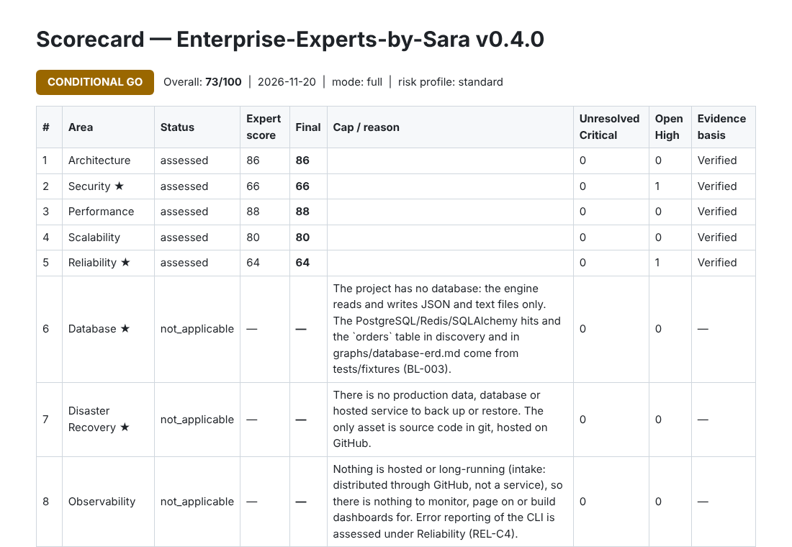
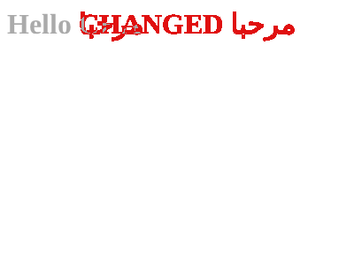

# Enterprise-Experts-by-Sara

**Enterprise Experts by Sara** is a Claude skill that turns Claude from an assistant that writes code into an **AI engineering team**: 23 specialist experts plus an **AI Engineering Orchestrator / Production Readiness Lead** who coordinates them, prevents conflicting changes, and hands back a **Final Project Health Report** with a score per area, the critical issues, the evidence, and a **Go / No-Go** recommendation.

The idea: instead of asking "is my project good?", you run a process that makes Claude **prove every conclusion** — what it checked, what it fixed, what passed, what failed, and what still needs a human.

> Results are not automatic just because the skill is installed. Claude needs suitable access to the project, tools to run and test it, clear standards, and limited permissions for sensitive operations. The readiness states below are targets, and each one needs evidence or a test result.

## What you get

| # | Area | Final deliverable |
|---|---|---|
| 1 | Architecture | Complete System Architecture + Diagrams |
| 2 | Security | Security Audit + Remediation Report |
| 3 | Performance | Performance Benchmark + Optimization Report |
| 4 | Scalability | Load Testing + Capacity Plan |
| 5 | Reliability | SLOs + Resilience Test Results |
| 6 | Database | Database Audit + Optimized Schema |
| 7 | Disaster Recovery | Backup + Tested Recovery Plan |
| 8 | Observability | Monitoring Dashboards + Alerts |
| 9 | Quality Assurance | Automated Test Suite + QA Report |
| 10 | DevOps | CI/CD + Deployment Pipeline |
| 11 | Infrastructure | Infrastructure Configuration + Capacity Plan |
| 12 | Cost Optimization | Cost Analysis + Budget Alerts |
| 13 | UI/UX | UX Audit + Design Improvements |
| 14 | Data Governance | Data Quality + Governance Report |
| 15 | APIs | API Contracts + Validation Tests |
| 16 | Business Logic | Business Rules + Workflow Validation |
| 17 | Documentation | Complete Technical Documentation |
| 18 | Incident Management | Incident Runbooks + Response Plan |
| 19 | Compliance | Compliance Gap Assessment |
| 20 | Analytics | KPI Dashboards + Product Reports |
| 21 | Technology Strategy | Technology Roadmap |
| 22 | Technical Leadership | Architecture + Code Review Reports |
| 23 | Engineering Delivery | Engineering Plan + Progress Tracking |
| ★ | Orchestration | **Final Project Health Report** (scores, critical issues, evidence, Go/No-Go) |

Target states: **Architecture Reviewed · Security Assessed · Testing Evidence-based · Performance Measured · Monitoring Configured · Deployment Repeatable**.

## How it works

```mermaid
flowchart TD
    U([You: "Run Enterprise Experts on this project"]) --> D[Discover the project<br/>stacks, checks, capability matrix]
    D --> Q[Ask you the intake questions<br/>risk profile and permissions]
    Q --> B[Baseline<br/>build, tests, lint, audit]
    B --> W1

    subgraph EXPERTS [23 experts, in five waves]
        direction LR
        W1[Foundation<br/>Architecture, Business Logic,<br/>Database, APIs] --> W2[Protection<br/>Security, Data Governance,<br/>Compliance]
        W2 --> W3[Runtime<br/>Performance, Scalability, Reliability,<br/>Observability, DR, Incidents]
        W3 --> W4[Delivery<br/>QA, DevOps, Infrastructure,<br/>Cost, UI/UX, Analytics]
        W4 --> W5[Synthesis<br/>Documentation, Tech Leadership,<br/>Strategy, Delivery]
    end

    W5 --> P{Fix anything?}
    P -- "you approve a plan" --> R[Remediation on a branch<br/>measure before and after,<br/>re-check, independent review]
    P -- "assess only" --> S
    R --> S[Engine validates and decides]
    S --> O([Final report and delivery package<br/>GO / CONDITIONAL GO / NO-GO])

    E[(Evidence log<br/>every command run and file read)]
    B -. records .-> E
    EXPERTS -. records .-> E
    R -. records .-> E
    E -. "decision is computed from this" .-> S
```

The decision at the end is made by the engine from the recorded evidence, not by the model's opinion.


1. **Discover, then ask.** The engine inventories the project (stacks, checks available, CI, containers, database, secrets scan). Claude then asks you the intake questions that fit this project: what it does, what data it holds, whether it moves money, what may be run and changed. The answers set a risk profile (standard, sensitive, regulated) and the release gates.
2. **Baseline.** Build, tests, lint, type-check and dependency audit are run where the project has them, and their output is captured as evidence.
3. **Expert assessment in waves** — Foundation → Protection → Runtime → Delivery → Synthesis. Evidence is recorded, not declared: *Verified* means a command ran and its output was captured; *Observed* means something was read at a cited location; *Inferred* is reasoning and can never support a pass.
4. **Remediation, with approval only.** Fixes go on a branch, one owner per change, and count as fixed only after a re-check ran.
5. **Decision.** The engine validates the whole review and returns GO, CONDITIONAL GO or NO-GO. It is fail-closed: a missing area, missing evidence or malformed input makes the review invalid, and an invalid review is NO-GO.

Three modes: **Full** (all 23 areas), **Quick** (8 areas), **Focused** (the areas you name; its decision covers that scope only).

## What the results look like

**The scorecard.** A real one: the skill's full 23-expert review of this repository at v0.4.0, which ended CONDITIONAL GO at 73/100 and found five High issues in the skill itself (all fixed in v0.5.0). It is a screenshot of the HTML scorecard the engine wrote; the [full image](docs/images/scorecard-self-review.png) also shows the conditions.



**Visual regression.** A screenshot is compared with the baseline you approved, and the engine draws where they differ. These three images are real engine input and output, from a small test page whose heading was changed:

| Approved baseline | New capture | Difference (2.1% of pixels, in red) |
|---|---|---|
|  |  |  |

Each review also produces the expert reports, an evidence log with the captured output of every check, `report.xlsx`, `report.pdf` and a delivery folder. More about what the runs so far did and did not show is in [docs/EVALUATION.md](docs/EVALUATION.md).

## Status: v0.5.1, not yet v1.0

What is implemented and tested, and what is not, is tracked honestly in [docs/ROADMAP.md](docs/ROADMAP.md). Enterprise Experts is one reusable skill, not a hosted product: there is no server, dashboard or database to run. You install it once and invoke it in any project; it works out what that project is and applies only what fits.

In short: the decision engine, intake, capability matrix, evidence recording, stack detection, scanner-result import, edit/command guard, before/after benchmarks, diagrams from code, screenshot comparison, delivery packaging, Docker runner and CI are implemented and covered by 157 automated tests. The skill has been run six times, including a full 23-expert review of this repository, and what those runs found (including serious defects in the skill itself, since fixed) is recorded in [docs/EVALUATION.md](docs/EVALUATION.md). It has not yet been run on a real project other than this one, nobody has judged the quality of its reports, and no release has been tagged.

## Install

**As a Claude Code plugin** (skill, two read-only subagents, and the hook that enforces read-only assessment):

```
/plugin marketplace add saradchamas/Enterprise-Experts-by-Sara
/plugin install enterprise-experts@enterprise-experts-by-sara
```

**As a standalone skill:** copy `skills/enterprise-experts/` into your skills folder, or upload the packaged `.skill` file in Claude.

Details, uninstall and verification: [docs/INSTALLATION.md](docs/INSTALLATION.md).

## Use

Open your project and say, for example:

- "Run Enterprise Experts on this project — full review."
- "Is this project production-ready? Quick health check."
- "راجع المشروع من كل الجهات وعطيني Final Project Health Report."
- "Enterprise Experts: only Security, Database and DevOps."

Output is written to `enterprise-review/<date>/` inside the project.

The engine also runs on its own, without Claude, for the deterministic parts:

```bash
python skills/enterprise-experts/scripts/enterprise_experts.py discover /path/to/project --out review
python skills/enterprise-experts/scripts/enterprise_experts.py score --review review
PROJECT_DIR=/path/to/project docker compose run --rm audit      # same, isolated
```

## Documentation

| Document | Contents |
|---|---|
| [docs/INSTALLATION.md](docs/INSTALLATION.md) | Install, verify, uninstall |
| [docs/USER_GUIDE.md](docs/USER_GUIDE.md) | Review workflow, CLI reference, files and exit codes |
| [docs/DOCKER.md](docs/DOCKER.md) | The isolated runner: what it does and does not do |
| [docs/SECURITY.md](docs/SECURITY.md) | Permissions, isolation, secrets, approvals |
| [Scoring specification](skills/enterprise-experts/references/evidence-and-scoring.md) | Evidence levels, schema, caps, gates |
| [Intake questions](skills/enterprise-experts/references/intake-questions.md) | What is asked and what each answer changes |
| [docs/DEVELOPER_GUIDE.md](docs/DEVELOPER_GUIDE.md) | Architecture, tests, adding adapters, questions and experts |
| [docs/UPDATES.md](docs/UPDATES.md) | Versioning, upgrading, rolling back |
| [docs/EVALUATION.md](docs/EVALUATION.md) | What has been measured about the skill, and what has not |
| [docs/ROADMAP.md](docs/ROADMAP.md) | Gap analysis, v1.0 checklist, known limitations |
| [CHANGELOG.md](CHANGELOG.md) | Changes per release |

## Notes

- The companion skills listed in `skills/enterprise-experts/references/companion-skills.md` are optional. Community skills vary in quality; inspect source code and permissions before installing any.
- The compliance deliverable is a gap assessment for a qualified person to review, not legal advice.
## Licence

[MIT](LICENSE) © 2026 Sara Darwich Chamas. The companion skills and tools mentioned in the documentation are separate projects with their own licences.
