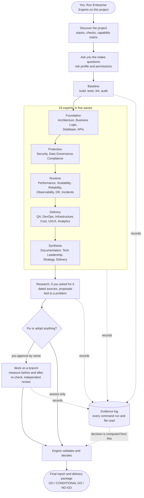
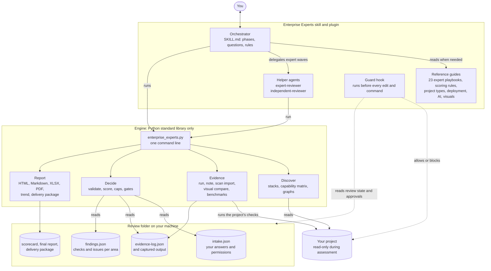
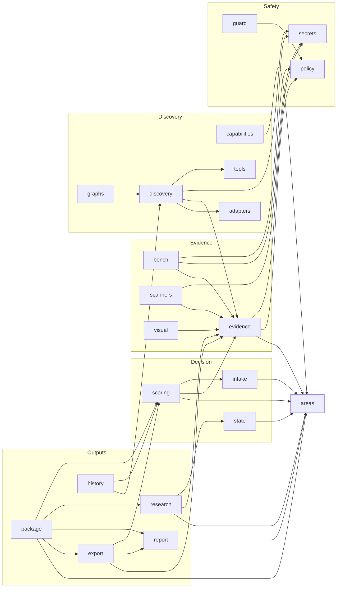
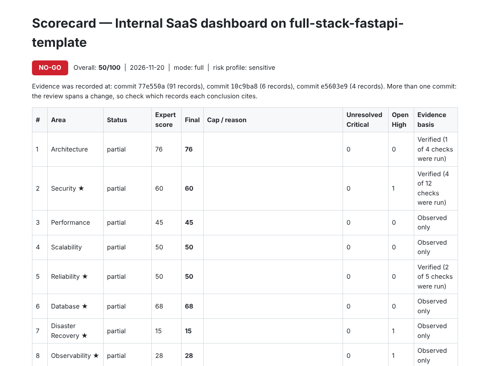
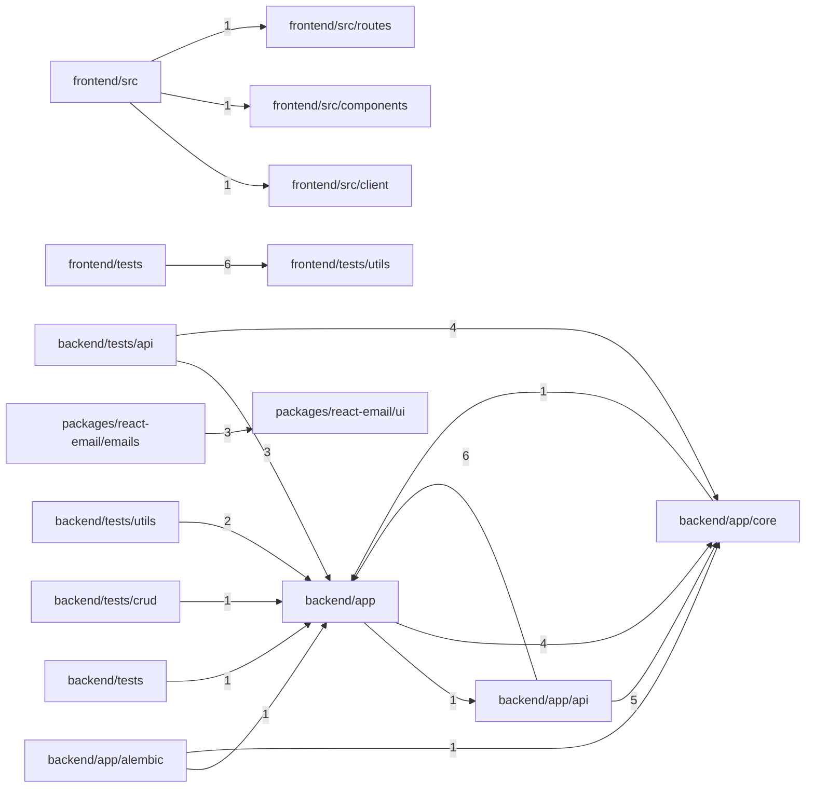
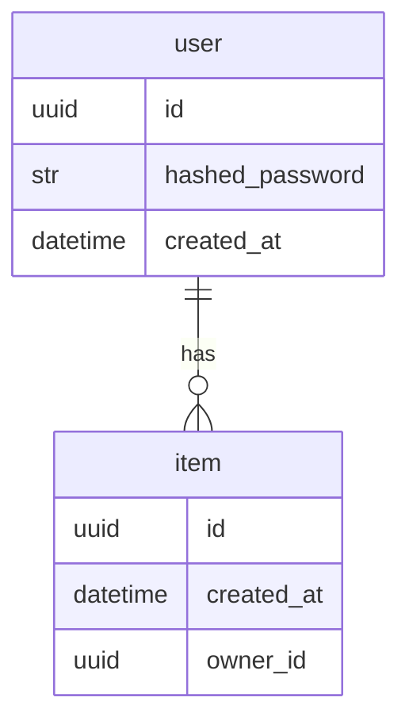
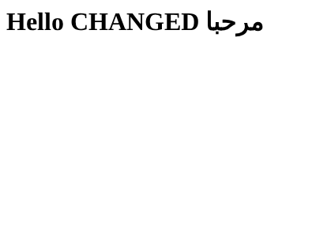

# Enterprise-Experts-by-Sara

**Enterprise Experts by Sara** is a Claude skill that turns Claude from an assistant that writes code into an **AI engineering team**: 23 specialist experts plus an **AI Engineering Orchestrator / Production Readiness Lead** who coordinates them, prevents conflicting changes, and hands back a **Final Project Health Report** with a score per area, the critical issues, the evidence, and a **Go / No-Go** recommendation.

The idea: instead of asking "is my project good?", you run a process that makes Claude **prove every conclusion** — what it checked, what it fixed, what passed, what failed, and what still needs a human.

**What it is:** one Claude skill, an orchestration workflow, and a small Python engine that records evidence and makes the decision. **What it is not:** a new AI model, 23 separate AI models, or a hosted platform. There is no server, dashboard or database; it runs where your project is.

It does three things:

1. **Reviews** the project across 23 areas and scores each one on evidence.
2. **Researches**, if you want it to: newer technologies, AI models, tools and MCP servers that would help this project, each proposal tied to a problem and to pages that were read, with URL and date.
3. **Builds** what you approve: fixes and approved proposals go on a branch, and count as done only after a check passed.

> Results are not automatic just because the skill is installed. Claude needs suitable access to the project, tools to run and test it, clear standards, and limited permissions for sensitive operations. The readiness states below are targets, and each one needs evidence or a test result.

## What you get

| # | Area | Final deliverable |
|---|---|---|
| 1 | Architecture | Complete System Architecture + Diagrams |
| 2 | Security | Security Audit + Remediation Report |
| 3 | Performance | Performance Benchmark + Optimization Report |
| 4 | Scalability | Load Testing + Capacity Plan |
| 5 | Reliability | SLOs + Resilience Test Results |
| 6 | Database | Database Audit + Optimized Schema |
| 7 | Disaster Recovery | Backup + Tested Recovery Plan |
| 8 | Observability | Monitoring Dashboards + Alerts |
| 9 | Quality Assurance | Automated Test Suite + QA Report |
| 10 | DevOps | CI/CD + Deployment Pipeline |
| 11 | Infrastructure | Infrastructure Configuration + Capacity Plan |
| 12 | Cost Optimization | Cost Analysis + Budget Alerts |
| 13 | UI/UX | UX Audit + Design Improvements |
| 14 | Data Governance | Data Quality + Governance Report |
| 15 | APIs | API Contracts + Validation Tests |
| 16 | Business Logic | Business Rules + Workflow Validation |
| 17 | Documentation | Complete Technical Documentation |
| 18 | Incident Management | Incident Runbooks + Response Plan |
| 19 | Compliance | Compliance Gap Assessment |
| 20 | Analytics | KPI Dashboards + Product Reports |
| 21 | Technology Strategy | Technology Roadmap |
| 22 | Technical Leadership | Architecture + Code Review Reports |
| 23 | Engineering Delivery | Engineering Plan + Progress Tracking |
| ★ | Orchestration | **Final Project Health Report** (scores, critical issues, evidence, Go/No-Go) |

Target states: **Architecture Reviewed · Security Assessed · Testing Evidence-based · Performance Measured · Monitoring Configured · Deployment Repeatable**.

## How it works



The decision at the end is made by the engine from the recorded evidence, not by the model's opinion.


1. **Discover, then ask.** The engine inventories the project (stacks, checks available, CI, containers, database, secrets scan). Claude then asks you the intake questions that fit this project: what it does, what data it holds, whether it moves money, what may be run and changed. The answers set a risk profile (standard, sensitive, regulated) and the release gates.
2. **Baseline.** Build, tests, lint, type-check and dependency audit are run where the project has them, and their output is captured as evidence.
3. **Expert assessment in waves** — Foundation → Protection → Runtime → Delivery → Synthesis. Evidence is recorded, not declared: *Verified* means a command ran and its output was captured; *Observed* means something was read at a cited location; *Inferred* is reasoning and can never support a pass.
4. **Remediation, with approval only.** Fixes go on a branch, one owner per change, and count as fixed only after a re-check ran.
5. **Decision.** The engine validates the whole review and returns GO, CONDITIONAL GO or NO-GO. It is fail-closed: a missing area, missing evidence or malformed input makes the review invalid, and an invalid review is NO-GO.

Three modes: **Full** (all 23 areas), **Quick** (8 areas), **Focused** (the areas you name; its decision covers that scope only).

**Beyond reviewing: research and build.** If you say yes at intake, the team also looks for newer technologies, AI models, tools and MCP servers that would help this project. Every proposal must name the problem it solves, cite pages that were read during the review (URL and date), and weigh an alternative; the engine refuses one that does not, and flags sources older than 90 days. You approve, reject or defer each proposal. An approved one is built on a branch and counts as verified only after a check passed afterwards. The research itself is done by Claude with whatever web access your session has; the engine keeps it honest, it does not browse.

## Architecture

One skill, four parts: instructions Claude reads, two helper agents, a guard that runs before every edit or command, and a small Python engine that records evidence and makes the decision. Nothing is hosted; everything runs on your machine and writes to one review folder.



### Engine module graph

How the engine's modules depend on each other. An arrow means "imports". `cli` is left out because it imports nearly everything; a test (`tests/test_readme_graph.py`) fails if this graph stops matching the code.

<!-- module-graph:start -->

<!-- module-graph:end -->

## What the results look like

**A real review of a real project.** The full skill was run on [fastapi/full-stack-fastapi-template](https://github.com/fastapi/full-stack-fastapi-template) at commit `77e550a`: all 23 experts, research, and two approved changes. The engine's decision was NO-GO at 50/100 with 49 findings (7 High, none Critical). The project's own code was not run and the "owner" answering the questions was simulated, so read it as a demonstration of the workflow, not as a verdict on that project. This is the top of the scorecard the engine wrote:



Two things on it are worth noticing. The line under the decision says which commits the evidence was recorded at. The last column does not just say "Verified": it says how many of an area's checks rest on something that was run, so a single shared run cannot make a whole area look tested.

**Diagrams from the code.** `graph` draws these from import statements and model definitions; nothing is drawn from memory. This is its output for the same project (one level deeper than the default), including the circular dependency it found between `backend/app` and `backend/app/api`:



The diagram above shows 17 of the 24 dependencies the engine reported, to keep it readable; the numbers are how many imports each arrow stands for. The database diagram comes from the project's SQLModel classes (columns inherited from base classes are not shown):



**The skill reviewing itself.** An earlier full review of this repository (v0.4.0) ended CONDITIONAL GO at 73/100 and found five High issues in the skill's own engine, all fixed since: [scorecard image](docs/images/scorecard-self-review.png).

**Visual regression.** A screenshot is compared with the baseline you approved, and the engine draws where they differ. These three images are real engine input and output, from a small test page whose heading was changed:

| Approved baseline | New capture | Difference (2.1% of pixels, in red) |
|---|---|---|
|  |  |  |

Each review also produces the expert reports, an evidence log with the captured output of every check, `report.xlsx`, `report.pdf` and a delivery folder. More about what the runs so far did and did not show is in [docs/EVALUATION.md](docs/EVALUATION.md).

## What it has been tested on

| What ran | On what | Result |
|---|---|---|
| The engine only (no model) | Flask, Express, Gin, the FastAPI full-stack template, Django: 130 to 7,104 files | Each command finishes in under 5 seconds. Exposed 8 defects in the engine, all fixed |
| The full skill: 23 experts, research, two approved changes | The FastAPI full-stack template | Completed; NO-GO 50/100, 49 findings. The reviewer reported 23 defects and frictions in the skill; the engine bugs among them are fixed |
| The full skill | This repository | CONDITIONAL GO 73/100; found 5 High issues in the engine, all fixed |
| Focused and quick reviews, a fix loop, AI and deployment workflows, real screenshots | Small sample projects in `tests/fixtures` | Recorded in the evaluation document |
| 204 automated tests | The engine | Pass on Linux, macOS and Windows, Python 3.10 and 3.13 |

What this does **not** yet show:

- No person has read the reports and judged whether the findings are right and useful. Every run so far was done by an agent of the same model that wrote the skill.
- In the real-project review the project's code was never executed: no test run, no build, no live request. The approvals came from a simulated owner.
- Nothing large or private has been reviewed. The biggest full review covered about 250 files.
- The edit guard has not been exercised inside a live Claude Code session.
- A full review costs roughly 300,000 to 400,000 tokens and 15 to 25 minutes.

The details, including what each run got wrong, are in [docs/EVALUATION.md](docs/EVALUATION.md).

## Status: v0.6.2, not yet v1.0

What is implemented and tested, and what is not, is tracked in [docs/ROADMAP.md](docs/ROADMAP.md). Implemented and covered by tests: the decision engine, intake, capability matrix, evidence recording, stack detection (npm, pnpm, yarn, Bun, pip, uv, Go, Java, PHP, Rust, Dart, Ruby, .NET, Terraform), scanner-result import, edit and command guard, before/after benchmarks, diagrams from code, screenshot comparison, research and proposals, delivery packaging, Docker runner and CI. No release has been tagged yet.

## Two editions

| | Full | Lite |
|---|---|---|
| Where | This repository (plugin `enterprise-experts`, or the `.skill` file) | `directory/enterprise-experts-lite/` (plugin `enterprise-experts-lite`) |
| Contents | Skill, Python engine, two agents, edit guard | Skill and two agents: Markdown and JSON only, no scripts, no hooks |
| Evidence log | Written by the engine, with captured output and hashes | Kept by Claude, by hand |
| Scores and decision | Computed and validated by the engine | Applied by Claude from the written rules |
| Unapproved edits | Blocked by a hook | A rule Claude follows |
| Diagrams from code, image comparison, benchmarks, Excel and PDF | Built in | By hand, or not available |

The Lite edition exists because plugin directories accept scripts and hooks only from verified publishers. It gives the method and the report; it cannot give an independent check that the method was followed, and it says so at the top of every scorecard. Everything in "What it has been tested on" above refers to the full edition. The Lite edition has not been evaluated in a review yet.

## Install

**As a Claude Code plugin** (skill, two read-only subagents, and the hook that enforces read-only assessment):

```
/plugin marketplace add saradchamas/Enterprise-Experts-by-Sara
/plugin install enterprise-experts@enterprise-experts-by-sara
```

**As a standalone skill:** copy `skills/enterprise-experts/` into your skills folder, or upload the packaged `.skill` file in Claude.

Details, uninstall and verification: [docs/INSTALLATION.md](docs/INSTALLATION.md).

## Use

Open your project and say, for example:

- "Run Enterprise Experts on this project — full review."
- "Is this project production-ready? Quick health check."
- "راجع المشروع من كل الجهات وعطيني Final Project Health Report."
- "Enterprise Experts: only Security, Database and DevOps."
- "Review this project, and also look for newer technologies, models and MCP servers that would help it."

Output is written to `enterprise-review/<date>/` inside the project.

Before it starts, the skill asks you what the project is for, what data it holds, what it may run and change, and whether it may look things up on the web. Nothing is changed, installed or adopted without your approval.

The engine also runs on its own, without Claude, for the deterministic parts:

```bash
python skills/enterprise-experts/scripts/enterprise_experts.py discover /path/to/project --out review
python skills/enterprise-experts/scripts/enterprise_experts.py graph /path/to/project --out review/graphs
python skills/enterprise-experts/scripts/enterprise_experts.py score --review review
python skills/enterprise-experts/scripts/enterprise_experts.py research check --review review
PROJECT_DIR=/path/to/project docker compose run --rm audit      # same, isolated
```

## Documentation

| Document | Contents |
|---|---|
| [docs/INSTALLATION.md](docs/INSTALLATION.md) | Install, verify, uninstall |
| [docs/USER_GUIDE.md](docs/USER_GUIDE.md) | Review workflow, CLI reference, files and exit codes |
| [docs/DOCKER.md](docs/DOCKER.md) | The isolated runner: what it does and does not do |
| [docs/SECURITY.md](docs/SECURITY.md) | Permissions, isolation, secrets, approvals |
| [Scoring specification](skills/enterprise-experts/references/evidence-and-scoring.md) | Evidence levels, schema, caps, gates |
| [Intake questions](skills/enterprise-experts/references/intake-questions.md) | What is asked and what each answer changes |
| [Research and innovation](skills/enterprise-experts/references/research-and-innovation.md) | How newer technologies, models and MCP servers are researched, proposed, approved and verified |
| [docs/DEVELOPER_GUIDE.md](docs/DEVELOPER_GUIDE.md) | Architecture, tests, adding adapters, questions and experts |
| [docs/UPDATES.md](docs/UPDATES.md) | Versioning, upgrading, rolling back |
| [docs/EVALUATION.md](docs/EVALUATION.md) | What has been measured about the skill, and what has not |
| [docs/ROADMAP.md](docs/ROADMAP.md) | Gap analysis, v1.0 checklist, known limitations |
| [CHANGELOG.md](CHANGELOG.md) | Changes per release |

## Notes

- The companion skills listed in `skills/enterprise-experts/references/companion-skills.md` are optional. Community skills vary in quality; inspect source code and permissions before installing any.
- The compliance deliverable is a gap assessment for a qualified person to review, not legal advice.
## Licence

[MIT](LICENSE) © 2026 Sara Darwich Chamas. The companion skills and tools mentioned in the documentation are separate projects with their own licences.
